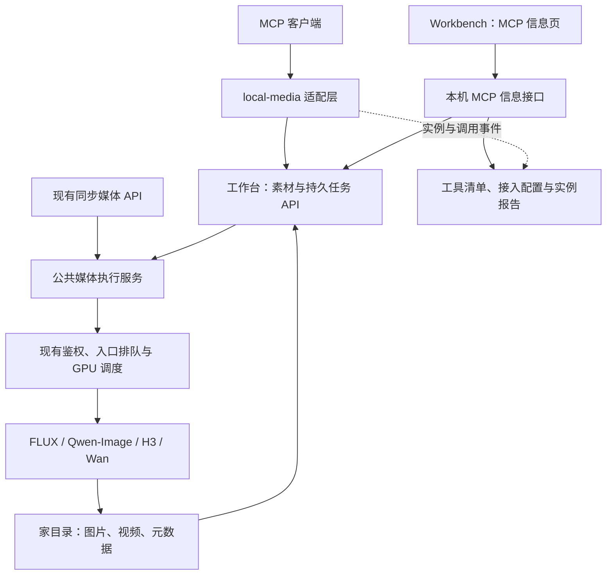

# 媒体模型 MCP 规划与 Workbench 信息展示

> 历史设计稿：首期已实现，Wan 分支已下线。当前使用说明见 [媒体 MCP](MEDIA_MCP.md) 与 [运行模式](RUNTIME_TOPOLOGY.md)，下文保留设计背景。

[文档目录](README.md) · [现有 API](CURRENT_API.md) · [模型调度](MODEL_SCHEDULING.md) · [生成物存储](DEVELOPMENT.md#外部生成物存储)

日期：2026-10-19（Asia/Shanghai）。状态：**本机 stdio 与 Workbench 信息页已实现并部署，四模型及 H3 条件参考验收通过**。使用方式与实际边界见 [本机媒体 MCP](MEDIA_MCP.md)。下文保留原设计和后续阶段规划，实施状态以使用文档与验收报告为准。依据现有 Workbench 页面、网关、媒体工作进程、鉴权代码及 MCP 官方资料。Workbench 增加 MCP 信息查看入口，展示接入、工具与调用情况。

## 1. 目标与推荐方案

提供一个名为 `local-media` 的 MCP，让支持 MCP 的客户端发现模型、导入参考素材、生成或编辑图片、生成视频、查询任务并获取作品。用户在现有 Workbench 页面查看这个 MCP 的部署、接入、工具和调用信息。

推荐结构：**工作台网关负责持久媒体任务，MCP 负责媒体工具和资源适配，Workbench 页面提供 MCP 信息面板。** 保留现有单卡调度与同步 API，提取共同执行逻辑，避免两套入口各自加载模型。

首期交付本机 stdio 接入、四个媒体模型调用和 Workbench 中的 MCP 信息页。远程 Streamable HTTP 接入作为后续阶段，需要完成身份、文件上传和下载链路。聊天仍使用现有聊天 API。



图中的任务 API、公共媒体执行服务、素材管理与 MCP 信息接口已落地为首期本机实现。MCP 信息页属于 Workbench 的界面功能；对外工具范围仍是媒体模型使用。

## 2. 设计时的能力与前置缺口

| 项目 | 已有实现 | MCP 接入需要补充 |
|---|---|---|
| MCP 信息展示 | 现有 Workbench 页面与任务记录可作为界面基础；尚无 MCP 面板 | 增加概览、接入配置、工具清单、实例与调用记录 |
| 模型发现 | `GET /v1/media/models` | 参数约束、默认值、能力版本及验证边界 |
| 生图 | 同步 JSON，返回 PNG base64 | 任务化执行、图片落盘、作品 ID 与缩略图 |
| 视频 | 同步等待 ComfyUI，成功后保存 MP4 | 持久任务、后端 prompt ID 落盘、恢复和结果领取 |
| 参考素材 | JSON base64；请求体上限 32 MiB | 素材 ID、上传/本机导入、避免大文件进入工具上下文 |
| GPU 调度 | 网关单进程租约、入口排队、引擎合批 | 任务执行复用同一调度器，新增任务状态回调 |
| 鉴权 | 访问密钥、并发、RPM 与有界等待 | 任务/素材/作品归属与按身份检查，异步配额边界 |
| 取消 | 请求断连只移除尚未运行的等待者 | 可取消排队任务；运行任务先明确返回不可取消 |
| 输出存储 | 已迁入家目录，旧路径为符号链接 | 素材索引、任务元数据和作品元数据关联 |

代码核对入口：`platforms/workbench/lib/http.mjs`、`media.mjs`、`access-keys.mjs`、`core.mjs`，以及 Qwen-Image 的 `runtime/reference_runtime.py`。

注意：现有视频实现等待历史记录最长约 30 分钟，超时不代表后端停止；现有指标最多保留少量记录，不能直接充当任务数据库。`CURRENT_API.md` 中“网关不校验 API Key”的概括仅适用于受信本机的无密钥/`Bearer local` 路径；显式密钥及公网请求已有鉴权，接入以代码为准。

## 3. 模型与能力边界

| 模型 | MCP 提供能力 | 首期参数与默认策略 |
|---|---|---|
| `flux2-klein` | 文生图 | `prompt`、`seed`；默认 Paiton，显式允许 Stock 对照；尺寸来自后端能力，不声明任意宽高 |
| `qwen-image21` | 文生图、透明图、1–4 图编辑 | MCP 默认 1024×1024；生成可选 2048×2048；编辑固定 1024×1024；40 步、guidance=1、每次一张 |
| `minimax-h3` | 文生视频、首尾帧、图片/视频/混合参考 | 无参考默认 turbo8；多模态参考默认 reference 20 步；显式选择对应四步预览 |
| `wan22` | 文生视频、首帧视频 | 名义 2 秒/5 秒分别映射现有 49/121 帧预设；无尾帧、任意多参考或音频参数 |

H3 保留现有约束：最多 9 张参考图、3 段参考视频；单段 2–15 秒，参考视频总时长不超过 15 秒；首尾帧与多模态参考不能混用；宽高各 320–1344、32 的倍数、面积不超过 1344×768。无多模态参考时帧数 124–364 且为 4 的倍数；参考模式接受 96–362 并按现有规则对齐。

工具结果同时返回 `requested_parameters` 与 `effective_parameters`，包括实际尺寸、帧数、帧率、时长、步数、seed 和音轨情况。后端未提供的有效值为 `null`，不能把输入值当作已验证输出值。不静默缩小分辨率、缩短视频或降低步数。

能力目录来自维护在代码中的 schema 与版本化约束，并结合现有发现接口；不能仅靠当前简略模型列表推测全部参数。发现、状态与预检不会加载 GPU。最高参数可接受不等于该参数组合已经验收。

## 4. 首期 MCP 工具

统一使用 `additionalProperties: false`，每个工具定义输入与结构化输出 schema。按模型使用明确的参数分支，拒绝混入其他模型的选项。

| 工具 | 主要输入 | 结果与行为 |
|---|---|---|
| `list_media_models` | 可选 `task: image_generate/image_edit/video_generate` | 模型、能力、约束、默认值、可用状态、验证边界；只读 |
| `import_media` | 本机 `path`、`kind: image/video` | 复制到素材库并返回 `asset_id`、格式、大小、像素/时长与 SHA256 |
| `generate_image` | `request_id`、`model`、`prompt`、模型选项 | 持久接受后立即返回 `job_id`，不等待生成 |
| `edit_image` | `request_id`、`prompt`、`reference_asset_ids[1..4]`、`seed` | 固定 Qwen-Image，返回 `job_id` |
| `generate_video` | `request_id`、`model`、`prompt`、参考素材及模型选项 | 返回 `job_id`，统一覆盖文生、首尾帧与混合参考 |
| `get_job` | `job_id`、`wait_seconds: 0..20`，默认 0 | 状态、真实阶段、作品、错误及建议下次查询时间 |
| `list_jobs` | 可选状态、游标、`limit: 1..50` | 仅当前身份可见的分页任务列表，支持断线后找回 |
| `cancel_job` | `job_id` | 移除尚未提交后端的任务；已运行时返回 `cancelled:false` 和原因 |
| `get_artifact` | `artifact_id`、`include_preview:false` | 元数据、资源链接、本机路径；显式请求时附小图预览 |

首期共 9 个媒体/任务工具；Workbench 信息页展示这份工具清单。

查询工具标注 `readOnlyHint:true`。生成和素材导入会写文件并消耗资源，不标为只读。幂等声明必须以实际实现为准。生成描述明确提醒会排队和切换 GPU 模型；客户端按其工具授权策略执行。

### 4.1 图像参数

- `generate_image` 分为 `flux2-klein` 与 `qwen-image21` 两种 schema 分支。
- Qwen 支持 `mode:text-to-image/rgba`、`size:1024x1024/2048x2048`；MCP 默认 1024，区别于现有工作进程默认 2048。
- FLUX 使用 `engine:paiton/stock` 的工具侧统一枚举，由适配器映射为 API 的 `Paiton` / `Stock (Diffusers)`；不向 FLUX 传 Qwen 的尺寸或模式。
- 共同 seed 使用 JSON 安全整数范围 0–9007199254740991；默认显式采用 42，避免跨语言精度丢失。Qwen 运行时自身支持更大的整数，MCP 首期收窄到上述范围。
- Qwen prompt 保留 1–512 字符约束；FLUX 的输入限制通过能力 schema 声明，不擅自套用 Qwen 上限。
- 编辑参考输入归一化为 PNG，合计像素不超过 4,194,304；透明图保留 alpha。

### 4.2 视频参数

H3 分支提供 `preset`、`width`、`height`、`frames`、`seed`、`first_frame_asset_id`、`last_frame_asset_id`、`reference_image_asset_ids`、`reference_video_asset_ids`、`reference_video_audio`、`reference_image_size` 和参考模式的 `steps/engine`。

Wan 分支提供 `duration_seconds:2/5`、`seed`、`engine:paiton/stock` 与 `first_frame_asset_id`。工具只暴露后端已有能力，显式拒绝尾帧、多参考和音频选项。

参考素材顺序固定映射到 `<Picture 1>`、`<Video 1>` 等标签。素材导入结果返回简短标签建议；不自动改写用户提示词或擅自改变参考素材职责。图生视频直接使用已生成图片的 `asset_id`，无需让模型读取和回传 base64。

### 4.3 提交与查询示例

以下为拟定工具参数，不是现有可调用接口。

```json
{
  "request_id": "cover-image-001",
  "model": "qwen-image21",
  "prompt": "清晨山间木屋，柔和雾气，电影构图",
  "mode": "text-to-image",
  "size": "1024x1024",
  "seed": 42
}
```

提交结果：

```json
{
  "job_id": "job_01...",
  "status": "queued",
  "model": "qwen-image21",
  "next_poll_seconds": 5,
  "cancellable": true
}
```

成功查询结果：

```json
{
  "job_id": "job_01...",
  "status": "succeeded",
  "progress": null,
  "artifacts": [
    {
      "artifact_id": "art_01...",
      "asset_id": "asset_01...",
      "mime_type": "image/png",
      "resource_uri": "media://artifacts/art_01...",
      "local_path": "/home/aoike/图片/llm-backend/MCP/job_01.../output.png"
    }
  ],
  "cancellable": false
}
```

将该 `asset_id` 用作 H3 首帧：

```json
{
  "request_id": "cover-video-001",
  "model": "minimax-h3",
  "prompt": "镜头缓慢推近木屋，雾气自然流动",
  "preset": "turbo8",
  "first_frame_asset_id": "asset_01...",
  "width": 864,
  "height": 480,
  "frames": 124,
  "seed": 771
}
```

客户端按返回的建议间隔查询；常规查询不持有执行名额，短等待最多 20 秒。通知只是辅助，不能要求 MCP 客户端在一次工具调用结束后持续接收进度。首期不依赖宿主自动唤醒或某种特定后台任务能力。

## 5. 持久任务与执行边界

### 5.1 任务状态

```text
queued → preparing → waiting_for_engine → dispatching → running → saving → succeeded
   └──────── 后端提交前可取消 ─────────┘
任意阶段 → failed（已知失败）
提交结果不确定或服务重启 → recovering → succeeded / failed / unknown
```

- `queued` 表示请求与输入快照已成功落盘；先落盘，再返回任务 ID。
- `dispatching` 是调用后端前的持久状态。后端接受后立即保存 `backend_prompt_id`，再标记 `running`；“后端已接受但 ID 未落盘”的窗口必须按不确定状态处理。
- `saving` 完成文件校验、原子写入、作品索引和任务结果提交后，才能标为 `succeeded`。
- 阶段进度来自真实事件。H3/Wan 若尚未接入逐步事件，只提供阶段与已用时间；`progress` 为 `null`，不估算百分比或承诺 ETA。
- `cancel_job` 与派发操作在同一状态锁内竞争；只有尚未进入 `dispatching` 才能返回取消成功。运行中首期 `cancellable:false`，不调用可能影响其他用户的全局 `/interrupt`。
- 客户端关闭、stdio 退出、轮询超时不会取消已接受任务。MCP 协议请求取消与媒体任务取消分别处理。

### 5.2 幂等、超时与恢复

- `(owner_id, request_id)` 唯一，另存规范化请求摘要及素材内容摘要；相同 ID 与相同请求返回原任务，内容不同返回 `IDEMPOTENCY_CONFLICT`。更换 seed 仍是不同请求。
- 请求超时后应查询原 ID，不自动生成新 ID 重提。工作进程已接受的请求不盲目重试；网络中断不能保证任务未执行。
- 首期不承诺跨崩溃的严格 exactly-once。提交不确定时标为 `unknown`，保留诊断信息，要求检查后显式新建任务。
- 视频已知 prompt ID 时可从 ComfyUI 历史恢复作品；图片若无法确认完成则保持不确定，不能根据重启行为宣称失败且自动重跑。
- 网关重启增加恢复屏障：恢复未派发队列；核对已派发任务及后端忙闲，在确认原任务完成/后端空闲前，不启动新的冲突 GPU 任务。凭据重建和结果回收需有明确测试。
- 现有 30 分钟视频等待限制需要调整成可配置后端执行期限，建议首期 60 分钟；这只是初始策略，必须按压力测试校准。超时后进入核对流程，后端仍忙时继续保护 GPU。
- 元数据按任务分文件保存、写临时文件、flush/fsync 后原子 rename；涉及唯一 ID 与队列状态的更新串行化。初期复用网关单进程约束，后续容量增长再迁数据库。

### 5.3 调度与配额

持久队列保存待执行任务；调度顺序仍由既有同引擎合批与公平让出策略决定。必须统一同步 HTTP 请求与异步媒体任务的候选选择，不能建一个独立 FIFO 绕过或长时间阻挡原有调用。

- 创建任务：鉴权、参数预检、素材访问权、幂等检查、每身份待办配额、落盘；不获得 GPU 租约。
- 执行任务：重新检查密钥状态，复用现有入口限额和 GPU 协调器；获得租约后定期续期，确认后端结束后释放。
- 任务提交计一次提交 RPM；轮询按独立读请求限额，不计生成并发。执行并发从真正进入执行入口到后端结束计算，不能在返回 job ID 时释放。
- 首期建议每身份最多 8 个未结束任务、全局最多 32 个；作为独立异步配额配置，不把当前访问密钥 `maxQueued` 自动等同为持久任务配额。
- 密钥撤销后，未派发任务停止执行并标记拒绝原因；已运行任务完成并收存，仍等待真实后端结束再释放资源。任务查询与作品下载每次都核验身份。

## 6. 素材与作品传递

### 6.1 输入素材

本机 `import_media` 接受文件路径，适配器只读允许目录，复制到素材库后返回 ID。默认允许 `/home/aoike/图片/llm-backend/`、`/home/aoike/视频/llm-backend/`；外部用户素材使用显式配置的导入目录。解析 `realpath` 后做包含关系检查，拒绝越界符号链接与非常规文件；打开后校验实际文件，避免路径检查与读取间被替换。

同一份受控输入按内容摘要去重，归属仍单独授权；不能通过猜 SHA256 读取别人的文件。不允许工具读取任意家目录、SSH 密钥或任意服务器文件。

图片检查真实文件格式、解码大小、像素、透明通道和方向；视频使用 `ffprobe` 检查实际时长、帧率、尺寸和音轨。视频归一化继续复用已有 H3 预处理，不在 MCP 中重复转码。

远程阶段新增认证的流式上传接口，由客户端传文件、服务端返回 `asset_id`。初期不提供任意 URL 抓取，避免 SSRF 与不可控下载；MCP 资源 URI 也不自动意味着服务器可读取客户端本地文件。

**大素材必须打通 asset ID 到后端文件上传的公共执行路径。** 不把素材 ID 在网关里重新展开成超过 32 MiB 的 JSON，不能宣称只改 MCP 入参就解决了大文件限制。原有同步 JSON API 继续保留原限制。

### 6.2 输出与预览

- MCP 使用 `structuredContent` 返回任务/作品元数据，并附简短文本摘要；`get_artifact` 通过 `resource_link` 提供作品资源。
- 提供 `media://models`、`media://jobs/{id}`、`media://artifacts/{id}`、`media://artifacts/{id}/metadata` 等资源；每次读取按身份校验。
- 图片可显式附缩略图，建议长边 512 px、编码后不超过 256 KiB；完整 PNG 通过资源或本机路径领取。
- 视频提供 `video/mp4` 资源链接、封面、时长和下载信息，不把整段视频塞入工具结果。大视频不强制经 `resources/read` 转 base64；本机使用文件路径，远程使用认证下载。
- 本机结果允许返回绝对 `local_path`；远程结果不泄露服务器路径。MCP 资源链接的显示、图片预览及视频播放取决于客户端支持，需要实际验收。
- 当前 `/artifacts/{id}.mp4` 不检查作品归属。新 MCP 作品下载必须经过带 owner 校验的新路由；不能直接暴露旧路径作为多用户下载地址。
- 远程下载默认要求授权头；客户端不能携带授权头时，再设计短时、只读、仅限单作品的签名链接。URL 中不得包含长期 API 密钥。

## 7. 存储与生命周期

沿用本项目已经迁出的家目录存储：

| 内容 | 建议实际路径 |
|---|---|
| MCP 生成图片 | `/home/aoike/图片/llm-backend/MCP/<job_id>/` |
| MCP 生成视频 | `/home/aoike/视频/llm-backend/MCP/<job_id>/` |
| 输入素材副本 | `/home/aoike/文档/llm-backend/MCP/素材/<asset_id>/` |
| 任务、作品索引、请求快照与事件 | `/home/aoike/文档/llm-backend/MCP/任务/<job_id>/` |
| 验证与运维记录 | `/home/aoike/文档/llm-backend/报告/mcp/` |
| 本机密钥与连接配置 | `~/.config/llm-backend/`，权限 0600，禁止进入工具结果 |

目录根通过配置传入，默认使用上述路径；项目仅保存源码、schema 和配置示例，不重新引入生成物。旧 API 的外部输出位置及兼容链接继续工作。新任务需统一写入/引用作品索引，避免无意义的多份完整媒体副本。

持久任务需要保存 prompt、参数和素材引用以支持幂等与恢复；这是现有指标“不存提示词”之外的新增数据。任务元数据按 owner 隔离、目录权限 0700，日志不打印 prompt、base64 或密钥。建议首期结束任务元数据保留 30 天、临时转码文件任务结束后清理、原始作品保留至用户删除；素材被未结束任务引用时不能清理。

写前检查空间并限制单用户导入体积与总任务存储。家目录所在分区与项目分区不同，不能以项目盘剩余容量推断家目录有足够空间。上述保留期和配额作为配置项，首次部署确定并记录。

## 8. 接入、协议版本与 Workbench 展示

### 本机首期

- 使用 Node.js，复用项目运行版本与 ESM 风格；独立 `platforms/mcp/` 包，推荐 TypeScript + Zod。
- 根据 2026-10-19 查阅的官方资料，TypeScript SDK v2 是实现 2026-07-28 协议的稳定线；选用 `@modelcontextprotocol/server` 并在实施时锁定经过测试的具体版本。不要直接复用旧示例中的 v1 包名。[SDK 官方文档](https://ts.sdk.modelcontextprotocol.io/v2/)
- 启动命令规划为 `./lab mcp stdio`，stdout 只输出协议消息，日志写 stderr。适配器退出不影响网关中已接受的任务。
- 首期配置 `MEDIA_GATEWAY_URL=http://127.0.0.1:18982`，用专用服务端密钥确定 owner 与配额；一个受信本机连接映射一个固定身份。不默认依赖无密钥旁路。
- 本地导入由适配器流式读取允许目录，再上传到网关素材 API；网关不向远程调用方开放任意服务器路径读取。
- 实施第一步确认实际目标客户端及支持的协议版本、资源显示方式。旧客户端若不支持 v2 对应协议，单独选择已验证的 legacy 适配器/SDK 路线，共享工具契约；不假设自动兼容。

### 远程后续

使用 Streamable HTTP `/mcp`，按目标协议交由 SDK 实现，默认只绑定回环地址，由 HTTPS 反向代理提供外部入口。2026-07-28 与旧版 Streamable HTTP 的连接行为不同，不能拼接两版协议示例。[官方传输规范](https://modelcontextprotocol.io/specification/2026-07-28/basic/transports/streamable-http)

完成 MCP 适用的授权发现、令牌受众检查、Origin/Host 检查及主体隔离；每次工具、资源、上传、下载都核验权限。复用项目身份记录不等于现有静态 API Key 已满足全部远程 MCP 授权要求。传入的 MCP 令牌不直接当作其他后端凭据转发，后端凭据由服务端配置。[官方授权规范](https://modelcontextprotocol.io/specification/2026-07-28/basic/authorization)

远程身份映射到独立内部 owner，由已验证的令牌主体确定，不能由工具参数指定，也不能让所有用户共用同一个作品所有者。适配层与网关之间的身份传递需要可验证的内部凭据或委托机制，网关拒绝调用方随意填写的 owner 头。

首期采用显式 `job_id` 和查询工具，因此不要求客户端支持 MCP Tasks。若后续接入 Tasks 扩展，只在能力协商通过后映射同一个持久任务中心，不另建任务系统。[官方 Tasks 扩展](https://tasks.extensions.modelcontextprotocol.io/specification/draft/tasks)

工具 schema、结构化结果、资源链接与错误形式遵循 [官方工具规范](https://modelcontextprotocol.io/specification/2026-07-28/server/tools)。业务失败用可解释的 `isError:true`，未知工具或非法协议消息交由 SDK 处理；各协议版本结果外层由 SDK 编码。

### Workbench 中查看 MCP 信息

#### 入口与页面组织

在现有 Workbench 导航中新增 **MCP** 入口，作为接入信息页，独立于 GPU 模型服务列表。页面包含以下四个标签页，沿用现有界面风格、任务详情和作品预览组件。

| 标签页 | 展示内容 | 首期交互 |
|---|---|---|
| 概览 | MCP 名称/版本、部署状态、支持传输、媒体模型、工具数量、最近活动、网关依赖健康 | 刷新信息、定位最近错误与关联任务 |
| 接入配置 | 本机 stdio 启动命令、工作目录、环境变量说明；远程阶段的 HTTP 地址与认证方式 | 选择经验证的客户端配置模板、复制配置、查看接入说明 |
| 工具清单 | 九个工具的名称、用途、输入输出 schema、参数示例、对应媒体模型与版本 | 搜索、展开参数与示例、复制调用示例 |
| 调用记录 | 时间、工具、实例/客户端标识（若可获取）、耗时、状态、错误、关联 job/artifact | 按工具/模型/结果筛选，打开任务、预览或领取已有作品 |

概览明确区分“未部署”“已部署但未观察到实例”“最近有实例报告”“信息已过期”“依赖异常”。当前方案尚未实施时只显示“未部署/规划中”，不能显示绿色运行状态或虚构连接数。

stdio 由客户端启动，可能同时存在多个独立实例，没有统一的常驻监听地址。界面把“配置已生成”“进程曾上报”“协议已初始化”“最近有工具调用”分别展示；网关健康不等于 MCP 已连接，实例心跳也不等于宿主当前仍保持协议连接。只有获得相应事件才能展示具体客户端名称和协议版本，缺失时显示未知。

远程地址仅在 HTTP 实际部署并完成配置后展示。页面不把本机 stdio 命令伪装成 HTTP URL，也不把普通推理 API 地址标成 MCP 地址。

#### 配置与连接信息

配置示例来自部署的真实版本清单与经验证的客户端模板。未验证的客户端显示通用启动参数和待验证说明，不伪造可直接使用的产品专用配置。示例中的密钥使用占位符或受保护的环境引用，复制动作不包含已有密钥明文；访问密钥管理继续使用现有独立页面。

首期展示和复制接入信息，不自动修改外部客户端配置，不自动安装 MCP。连接检查只能做无副作用的依赖检查或协议初始化/工具发现，不能调用生图、视频来证明连通。stdio 实例无法被页面远程探测时显示“等待客户端启动并上报”，并提供手动验证步骤。

#### 数据来源与调用关联

| 页面信息 | 权威数据来源 | 需要新增的记录 |
|---|---|---|
| 名称、版本、传输和工具定义 | MCP 构建/注册时生成的同一份 manifest | 版本与 schema 摘要、构建标识；工具文档不手工复制两套 |
| 启动命令、工作目录、接入地址 | 服务端部署配置与本机路径解析 | 经过校验的公开配置视图，排除密钥和内部凭据 |
| stdio 实例与最近活动 | MCP 适配层主动注册、心跳和调用事件 | `instance_id`、版本、启动/最后报告时间、可选客户端/协议信息 |
| 网关依赖健康 | 现有受控健康查询 | 单独呈现网关状态及检查时间，不推导 MCP 连通 |
| 工具调用结果 | 适配层的调用开始/结束事件 | `call_id`、工具名、owner、时间、耗时、结果及脱敏错误码 |
| 生成进度与作品 | 持久媒体任务与作品索引 | `job_id`、`artifact_id`，页面复用同一份任务结果 |

生成工具很快返回 `job_id`，“调用完成”表示提交成功，不能显示为图片/视频已生成。调用记录分别显示 `call_status` 与 `job_status`；任务详情显示真实阶段和作品。轮询调用单独计数，不能把十次 `get_job` 算成十次生成。

同一客户端可能不提供稳定身份，`instance_id` 不能充当 owner，也不能通过客户端显示名称授权。事件接收由适配层凭据认证，owner 取自服务端身份映射。页面调用记录默认显示参数摘要，避免记录 prompt、素材内容、base64 与密钥。

#### 信息接口与生命周期

新增本机管理接口 `/api/mcp/overview`、`/api/mcp/config`、`/api/mcp/tools`、`/api/mcp/calls`，仅用于 Workbench 页面读取。复用现有本机管理接口的同源/Host 校验模式，不加入公网推理白名单。接口带 `observed_at`、`last_reported_at`、`stale`、分页/截断标记；未部署或记录缺失时返回明确空状态。

适配层通过单独认证的内部报告通道上报实例与调用事件，该通道不与页面只读接口混用。上报失败不影响已接受的生成任务；页面将遥测标为缺失，不把缺失当成没有调用。对重复事件按实例和调用 ID 去重，乱序事件不能把已结束调用退回运行中。

实例心跳建议每 15 秒，超过 45 秒未报告显示“信息过期”；这是可配置的初始策略，并非进程存活或协议断开判定。调用记录建议保留 30 天并做有界分页，写入家目录 `/home/aoike/文档/llm-backend/MCP/调用记录/`。页签隐藏时暂停轮询，默认响应不包含完整 schema、全部调用或媒体文件。

Workbench 本机管理者可查看本机实例与全局脱敏调用记录；后续若扩展远程工作台访问，再按 owner 过滤任务和作品。原始容器日志沿用已有引擎日志入口，MCP 面板只增加接入/调用诊断，不复制一套系统运维面板。

## 9. 拟新增/改造位置

```text
platforms/mcp/
  package.json / package-lock.json
  src/server.ts                 工具、资源注册与协议适配
  src/gateway-client.ts         异步任务/素材 API 客户端
  src/manifest.ts               与工具注册共用的名称、版本、schema 清单
  src/telemetry.ts              实例与调用事件的认证上报
  src/import-policy.ts          本机允许目录与安全读取
  src/schemas.ts                工具契约和模型分支
  tests/                        协议与适配测试
  README.md                     客户端配置与能力说明
platforms/workbench/lib/
  mcp-info.mjs                  部署信息、工具清单、实例与调用记录聚合
  mcp-info-routes.mjs            本机 MCP 信息页接口及独立内部上报处理
  media-service.mjs             从现有 http/media 提取的公共执行逻辑
  media-capabilities.mjs        模型参数和版本化约束
  media-assets.mjs              素材和作品索引、归属、流式上传
  media-jobs.mjs                持久状态、幂等、恢复与取消
  media-routes.mjs              新的任务/素材/下载路由
platforms/workbench/app/
  mcp-panel.jsx                MCP 概览、接入、工具与调用记录页面
```

规划中的 REST 支撑接口（均未实现）：

| 方法 | 路径 | 作用 |
|---|---|---|
| GET | `/api/mcp/overview` | Workbench 读取部署概况、实例与依赖健康 |
| GET | `/api/mcp/config` | 读取不含密钥的接入配置和模板 |
| GET | `/api/mcp/tools` | 读取与实际注册一致的工具清单及 schema |
| GET | `/api/mcp/calls` | 分页读取调用记录与关联任务 ID |
| POST | `/v1/media/assets` | 认证流式上传并返回素材 ID |
| POST | `/v1/media/jobs` | 创建任务，要求幂等 request ID，返回 202 |
| GET | `/v1/media/jobs` | owner 过滤与游标分页 |
| GET | `/v1/media/jobs/{id}` | 查询或有界短等待 |
| POST | `/v1/media/jobs/{id}/cancel` | 尝试取消未派发任务 |
| GET | `/v1/media/artifacts/{id}` | 认证作品元数据 |
| GET | `/v1/media/artifacts/{id}/content` | owner 校验后的文件流/Range 下载 |

`/api/mcp/*` 是本机 Workbench 信息接口，不是 MCP 工具或公网媒体 API。客户端实际调用的 MCP 工具仍只有第四节九个；页面只读接口、认证内部事件上报与媒体任务 API 分别鉴权。

补充 `lib/access-keys.mjs` 新路由的鉴权与配额分类，以及远程阶段代理路径白名单；不能因为沿用 `/v1/` 前缀就假定公网路由已经可达。继续兼容现有同步 API，不以网关递归 HTTP 调用自己的方式执行异步任务，以免重复计费、重复排队与持有两份租约。

## 10. 分阶段实施与验收

### P0：协议与能力契约

产出九个媒体工具的 schema、模型能力表、参数映射、任务状态和错误目录，同时确定 Workbench MCP 信息页的 manifest、实例与调用记录字段及空状态。用实际目标客户端验证 SDK 初始化、工具发现、结构化结果、资源链接及本机图片预览。确定用户输入素材目录和默认存储配额。此阶段无需模型推理。

### P1：本机媒体 MCP 与 Workbench 信息页

先抽取公共执行服务、落地任务与素材 API，再接入 stdio 的九个媒体/任务工具；同步实现 Workbench 的 MCP 信息页、manifest 读取、实例报告与调用记录。一次覆盖 FLUX、Qwen 文生/透明/编辑、H3 三类参考和 Wan 首帧；高级模型能力能否发布，以对应端到端验收为准。

首个闭环：在 Workbench 复制 MCP 接入配置 → 客户端发现工具并提交生图 → Workbench 查看调用及关联任务 → 领取图片并用于图生视频 → 页面跟踪任务并预览作品。工具链为 `generate_image → get_job → get_artifact → generate_video → get_job → get_artifact`。排队取消、断线找回、幂等、防越权、后端忙状态保护和家目录落盘都属于首期完成条件。

### P2：体验与远程接入

补齐视频真实进度事件、面板任务高级筛选与诊断视图、认证上传下载、Streamable HTTP、远程身份与客户端兼容验收。任务级运行中取消必须先实现可靠的后端任务定位与取消确认，再向外宣告支持。Tasks 扩展按客户端需要加入。

### 验收清单

| 场景 | 通过条件 |
|---|---|
| 协议连接 | 目标客户端发现固定工具集合；stdout 无普通日志；版本不兼容时明确报错 |
| Workbench 展示 | 页面工具清单与注册 manifest 一致；未部署、未观察到实例与过期状态不误报为已连接 |
| 接入与调用记录 | 复制配置无密钥明文；提交完成与生成完成分开；调用可定位同一 job/作品，重复事件不重复计数 |
| 展示边界 | 本机管理页接口不公开到推理 API；打开 MCP 页面不触发生成或修改外部客户端配置 |
| 参数与素材 | 不支持的模型参数、越界路径、超大/畸形媒体在 GPU 调度前拒绝 |
| 生图与编辑 | FLUX、Qwen PNG、RGBA、多图编辑分别实测；有效参数与输出文件一致 |
| 视频 | H3 文生、首尾帧、多图、多视频、混合参考；Wan 文生/首帧分别覆盖，引用标签顺序正确 |
| 组合使用 | 已生成图片以 asset ID 进入视频，生成过程中模型上下文没有大块 base64 |
| 任务生命周期 | 重复提交只产生同一逻辑任务；冲突请求拒绝；断开客户端后仍可找回 |
| 取消与崩溃 | 尚未进入引擎加载的排队任务取消后不加载模型；已在加载阶段取消时不提交推理；运行中不误报取消；提交窗口崩溃不盲目重跑 |
| 调度 | 同步和异步混合请求保持单卡互斥、配额、公平性及真实任务完成后的释放 |
| 归属与存储 | 其他身份不能查任务/读素材/领作品；图片视频实际在家目录，项目无新媒体实体 |
| 回归 | 原有聊天、生图、视频和 ComfyUI 工作流不退化；运行项目现有相关测试 |

真实推理验收先用较低成本预设覆盖链路；高分辨率、长视频与最大多参考属于单独验收，不能用 schema 单元测试替代。生成样本和报告继续存到家目录；规划阶段不触发推理、模型切换或服务变更。

## 11. 待实施时确认

当前方案默认本机客户端先接入。实施前仅需收敛目标客户端和协议版本、素材导入目录、磁盘配额，以及是否需要首轮远程访问。这些选择不影响“媒体 MCP 调用模型、Workbench 展示 MCP 信息、现有网关持有任务与调度”的主体结构。
