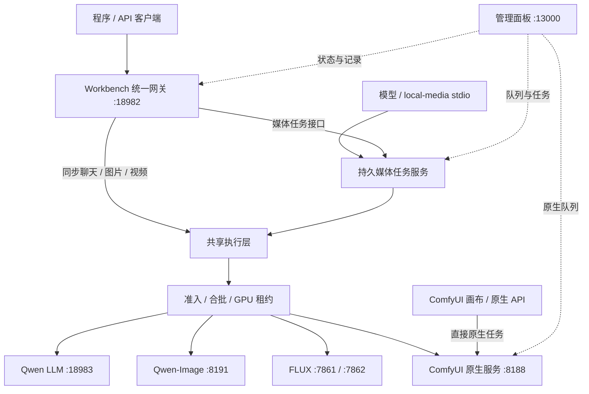

# 当前运行与调度模式

更新：2026-10-20（Asia/Shanghai）。这是当前部署的统一说明；历史评测、旧交接和规划不代表现行结构。

[文档目录](README.md) · [API](CURRENT_API.md) · [MCP](MEDIA_MCP.md) · [调度策略](MODEL_SCHEDULING.md)

## 一、四个模型服务，两种接入

**单 GPU、按需启动、跨后端冷切换。API 与 MCP 共用任务执行和 GPU Coordinator。ComfyUI 作为独立原生工作流服务，检测与排队覆盖全部工作流；MCP 接入独立图像服务，并单独注册金鱼原版工作流。Wan 已下线。**

MCP 不是第二个调度器，也不直接启动 GPU。持久任务服务、同步 API 与调度器在同一 Node.js 进程中运行，必须单实例部署。CPU 视觉编码和指标采集单独运行。

## 二、运行后端与端口

后端映射统一维护于 `platforms/runtime-topology.json`，供调度、API/MCP 能力信息、管理页面及 ComfyUI 控制器读取。

| 模型 / 调度键 | 运行容器 | 端口 | 用途 |
| --- | --- | --- | --- |
| `qwen38-27b-w3a4` / `llm` | `paiton-qwen38` | 18983 | 聊天、视觉与推理 |
| `qwen-image21` / `qwen-image` | `paiton-qwen-image21` | 8191 | 生图、透明图、编辑 |
| `flux2-klein` / `flux` | `paiton-flux2-paiton-1` / `paiton-flux2-stock-1` | 7861 / 7862 | 两种图像实现 |
| `minimax-h3` / `h3` | `paiton-h3-comfyui-1` | 8188 | 原生视频执行与画布 |

公共入口为面板 13000、统一推理 18982、租约控制 18990；全部本机回环。8190、8192 和旧 CPU `ai-comfyui` 均不属于当前模式。

## 三、调度与任务记录

1. 同步 API 请求或持久媒体任务校验参数、准备素材。
2. 使用有效密钥的请求按身份额度准入，再进入统一 GPU 合批与租约调度。本机同步兼容调用仍可使用原有可信路径；它也必须取得 GPU 租约。
3. 同一后端可复用；更换后端前连续两次确认旧后端空闲，再停止旧容器、启动目标容器并检查就绪。
4. 同模型 LLM 可以共享租约；媒体任务独占。续租周期 30 秒，租约有效期 120 秒；后端忙时不提前释放。
5. 请求结束保留最后使用的后端，下一类任务按需切换。CPU 权重驻留关闭。

`platforms/scheduler/scheduling.json` 当前配置为最小合批 2、最大合批 4、批次 120 秒、其他引擎等待老化 300 秒。冷启动完成后才计批次时间；具体让出条件见调度说明。

| 记录 | 来源与范围 | 去哪里看 |
| --- | --- | --- |
| 持久媒体任务 | API `/v1/media/jobs` 与 MCP 的生图、编辑、视频工具；有 `job_id`，按身份隔离 | 任务中心 → 媒体持久任务；API/MCP 查询 |
| 网关请求记录 | 最近 30 条完成统计，含同步请求和媒体执行统计；不是作品全集 | 任务中心 → 网关请求记录；各服务监控 |
| ComfyUI 原生队列/历史 | 全部 ComfyUI 原生工作流，不按模型或节点类型过滤；以 `prompt_id` 标识 | 模型服务 → ComfyUI；任务中心 → 原生队列与历史 |

这些计数不能直接相加。直接画布任务不自动拥有网关 `job_id`，也不保证进入 Workbench 最近请求统计。切换后端会检查原生队列是否空闲，但画布的提交入口仍在 ComfyUI 自身；若需完整统一准入与任务追踪，应通过 API / MCP 提交。直接画布任务与网关任务同时提交存在绕过全局准入的边界。

## 四、ComfyUI 边界

只保留 7 个 H3 原生模板（含唯一金鱼原版）。不挂载 Wan、Qwen-Image、FLUX 或网关 API 桥接节点，不在画布内跨服务切换模型。

MCP 暴露生图、编辑与视频生成三类工具；视频生成由 `generate_video` 统一入口，底层是专门授权的 H3 原版工作流，其他原生工作流不自动注册。ComfyUI 原生工作流直接通过 8188 的 `/prompt`、`/queue`、`/history`、`/system_stats` 等接口调度和检测。原有 Workbench 同步视频 API 保留兼容，与 MCP 能力清单分开。

ComfyUI 随 H3 后端运行；切到独立 LLM / 图片后端会停止它。`./lab comfyui start` 通过调度器切回 H3，不再创建 CPU 实例；查询状态、能力与队列不启动模型。

## 五、面板结构

| 导航 | 内容 |
| --- | --- |
| 总览 | 当前后端、GPU 租约、队列、服务入口与共享设备 |
| 任务中心 | 持久任务、请求统计、ComfyUI 全部原生队列与历史、作品预览与下载 |
| 模型服务 | 四个服务的监控、配置、任务耗时和日志；LLM 保留配置应用功能 |
| API | 地址、鉴权边界、同步/持久任务接口、媒体能力 |
| MCP | stdio 接入、九个工具、实例上报、调用记录 |
| 访问管理 | API / MCP 身份、密钥、并发、频率与等待额度 |

模型目录展示支持能力，不代表权重已加载。网关 `/health` 为 ready 也不保证任一推理后端已就绪。

## 六、磁盘与旧资料

Docker：`/mnt/Code/.runtime/docker`；containerd：`/mnt/Code/.runtime/containerd`。模型仍在 `/mnt/Code` 数据分区，作品和报告按分类目录保存。

Wan 专用镜像已删除，当前引擎注册、API、MCP、模板和 H3 容器挂载均移除 Wan。已有作品与历史评测保留；2026-10-23 另清理了 Wan 的模型缓存、运行时依赖与原生节点包，以及 Grafana 镜像、历史数据与密码文件。未对其他闲置镜像执行全局清理，以免删除 H3/LLM/图像的共享依赖。

### ComfyUI 服务检测范围

Workbench 直接读取 ComfyUI `/system_stats`、`/queue` 和 `/history?max_items=100`。服务页显示全部原生工作流的运行数、排队数与最近执行历史，不依据 H3 节点分类。只返回任务编号、状态与耗时，不返回提示词和工作流输入。未知或新增原生节点无需修改面板注册。读取失败显示不可用，不能作为队列空闲的依据。GPU 切换继续检查整个原生队列。现有启动命令、容器名和内部调度键 `h3` 保留兼容；它们不限制检测范围，也不声称已安装其他工作流。

视频生成的例外：`generate_video`（旧名 `run_goldfish_workflow` 兼容）通过既有持久任务和 GPU 准入管理执行，仅按白名单开关编译原版 API 图的节点与旁路后提交到 ComfyUI 原生 `/prompt`；它就是这个工作流的对外名称。
