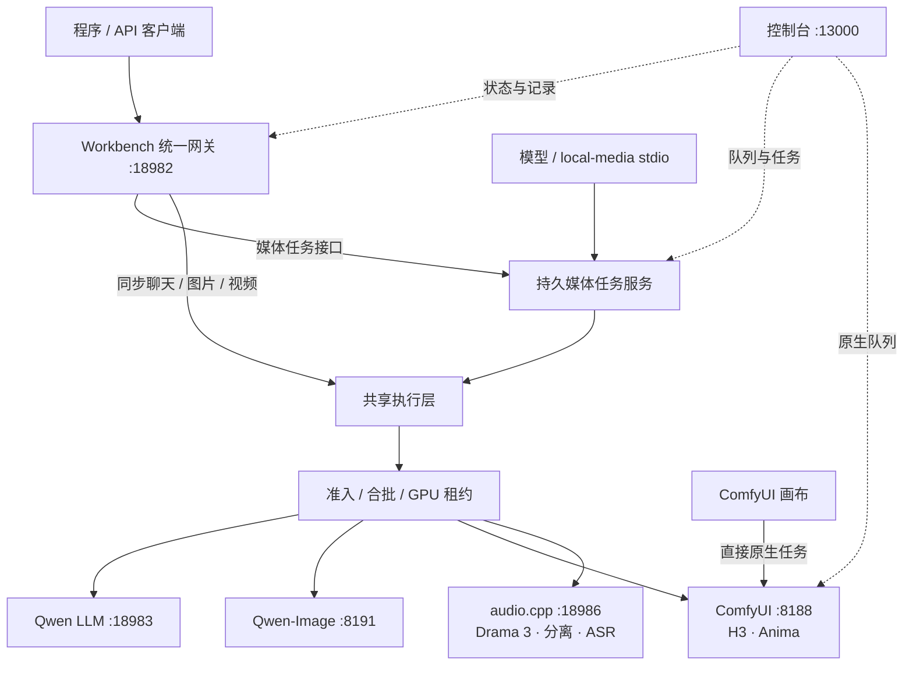

# 当前运行与调度模式

更新：2026-11-02（Asia/Shanghai）。本文是当前部署的统一说明。

[文档目录](../README.md) · [API](../api/CURRENT_API.md) · [MCP](../api/MEDIA_MCP.md) · [调度策略](MODEL_SCHEDULING.md) · [ComfyUI](../runtime/COMFYUI.md)

## 一、引擎、运行时与接入

**单 GPU、按需启动、跨运行时冷切换。** API 与 MCP 共用任务执行和 GPU Coordinator。引擎由 `engines/` 下的引擎包注册；同一运行时上的引擎（H3 与 Anima 共用 ComfyUI，三个音频引擎共用 audio.cpp）之间切换不重启容器。

MCP 不是第二个调度器，也不直接启动 GPU。持久任务服务、同步 API 和调度器运行在同一个 Node.js 进程里，所以必须单实例部署。CPU 视觉编码和指标采集单独运行。

## 二、运行时与端口

运行时、端口和容器都由各引擎包 `engine.json` 的 `platform.runtime` 声明。网关按启用状态实时推导，调度、API/MCP 能力信息、控制台和 ComfyUI 控制器都从这里读取；平台级端口见 `platforms/platform.json`。接入规范见 [引擎目录](ENGINES.md#接入新引擎)。

| 运行时 | 引擎 / 模型 | 容器 | 端口 | 能力 |
| --- | --- | --- | --- | --- |
| llm | `llm` / `qwen38-27b-w3a4` | `paiton-qwen38` | 18983 | 聊天、视觉、推理 |
| qwen-image | `qwen-image` / `qwen-image21` | `paiton-qwen-image21` | 8191 | 生图、透明图、编辑（主推） |
| comfy | `h3` / `minimax-h3` | `paiton-h3-comfyui-1` | 8188 | 视频生成 |
| comfy | `anima` / `anima` | 同上 | 8188 | 动漫生图、图生图（降级） |
| audiocpp | `fish-drama3`、`bs-roformer`、`qwen3-asr` | `paiton-audiocpp` | 18986 | 语音合成、人声分离、语音识别 |

公共入口是控制台 13000、统一推理 18982、租约控制 18990，全部监听本机回环。

## 三、调度与任务记录

1. 同步 API 请求或持久媒体任务先校验参数、准备素材。
2. 带有效密钥的请求先检查请求频率，再进入唯一的 GPU 队列；队列按引擎合批、引擎容量和密钥并发发放租约，排队不占密钥并发。本机同步兼容调用仍走原有的可信路径，但同样必须取得 GPU 租约。
3. 同一运行时直接复用，合批也按运行时计算：H3 与 Anima、三个音频引擎各自算作同一批，优先互相接续。更换运行时前，连续两次确认旧运行时空闲，再停止旧容器、启动目标容器并检查就绪。
4. 同引擎请求按容量共享租约：LLM 按面板设置的并发，图像与视频独占。续租周期 30 秒，租约有效期 120 秒；后端忙时不提前释放。
5. 请求结束后保留最后使用的运行时，下一类任务来了再按需切换。

`platforms/scheduler/scheduling.json` 当前配置：最小合批 2、最大合批 4、批次 120 秒、其他引擎等待老化 300 秒。批次计时从冷启动完成后开始；具体的让出条件见调度说明。

| 记录 | 来源与范围 | 去哪里看 |
| --- | --- | --- |
| 持久媒体任务 | API `/v1/media/jobs` 与 MCP 生成工具；有 `job_id`，按身份隔离 | 任务中心 → 媒体持久任务；API/MCP 查询 |
| 网关请求记录 | 最近 30 条完成统计，含同步请求和媒体执行；不是作品全集 | 任务中心 → 网关请求记录；各服务监控 |
| ComfyUI 原生队列与历史 | 全部原生工作流（含画布任务），以 `prompt_id` 标识 | 任务中心 → ComfyUI 原生队列 |

这三类计数不能直接相加。直接画布任务没有网关 `job_id`，也不一定进入网关最近请求统计。切换前虽然会检查原生队列是否空闲，但画布的提交入口在 ComfyUI 自身，会绕过全局准入；需要统一准入与追踪时，应通过 API / MCP 提交。

## 四、ComfyUI

ComfyUI 按需运行，没有 systemd 单元：路由到 `h3` 或 `anima` 的请求会拉起它，`./lab comfyui start` 也会通过调度器拉起它；切换到其他运行时时，等 `/queue` 空闲后停止。查询状态、能力与队列都不会启动模型。

MCP 的 `generate_video` 底层是 H3 金鱼原版工作流；`generate_image` 可以路由到 Anima（主推是 Qwen-Image）。其他画布模板不自动注册为工具。目录、挂载与模板说明见 [ComfyUI 运行时](../runtime/COMFYUI.md)。

控制台不为 ComfyUI 单独设卡片：H3 与 Anima 各自的卡片只显示自己的工作流任务，配置页给出共用运行时与画布入口。任务中心直接读取 ComfyUI 的 `/system_stats`、`/queue` 和 `/history?max_items=100`，展示全部原生工作流的运行数、排队数和最近历史；只返回任务编号、状态和耗时，不返回提示词和输入。读取失败时显示不可用，并且不把它当作队列空闲的依据。

## 五、控制台结构

| 导航 | 内容 |
| --- | --- |
| 总览 | 当前运行时、GPU 租约、队列、服务入口与共享设备 |
| 任务中心 | 持久任务、请求统计、ComfyUI 原生队列与历史、作品预览与下载 |
| 模型服务 | 每个引擎一张卡片（H3、Anima 各自独立）：监控、配置、任务耗时和日志；LLM 额外提供配置应用 |
| 引擎 | 已安装引擎包、启用开关、能力的主推与降级 |
| API / MCP | 地址、鉴权边界、接口、工具和调用记录 |
| 访问管理 | API / MCP 身份、密钥、并发、频率与等待额度 |

模型目录只展示支持的能力，不代表权重已加载。网关 `/health` 为 ready 也不保证任何推理后端已就绪。

## 六、磁盘

Docker 数据在 `/mnt/Code/.runtime/docker`，containerd 数据在 `/mnt/Code/.runtime/containerd`。模型在 `/mnt/Code` 数据分区，作品和报告按分类目录保存。镜像与层的空间说明见 [容器存储](../runtime/CONTAINER_STORAGE.md)。
